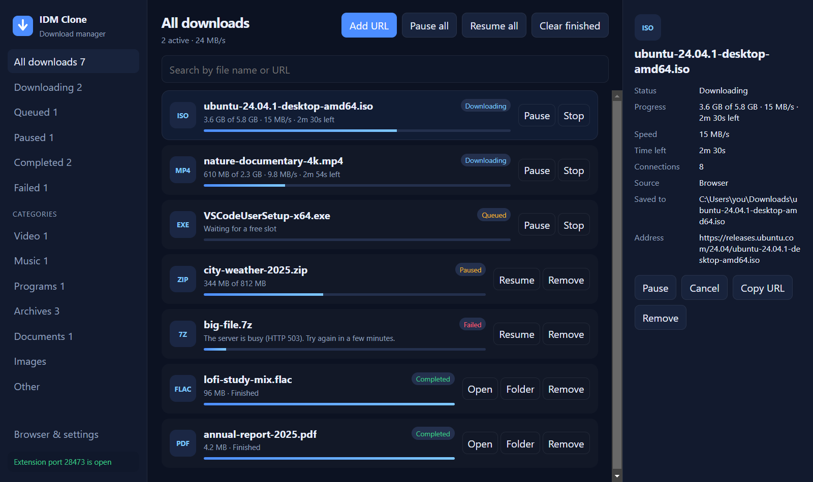
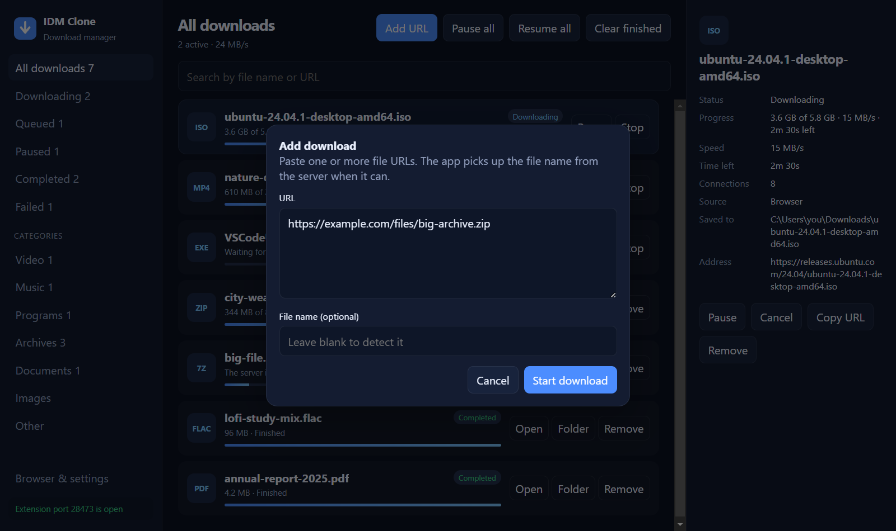
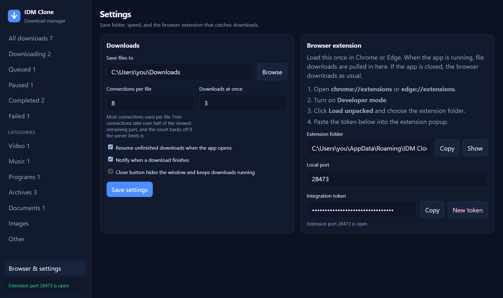
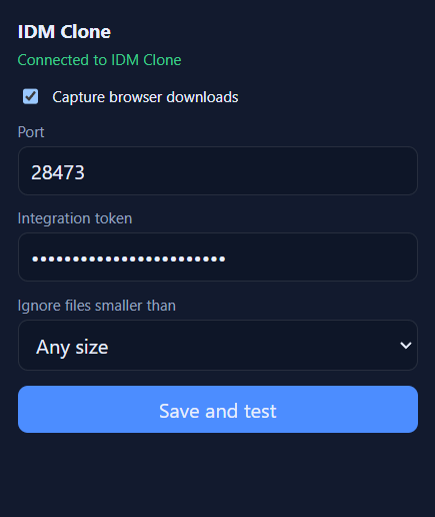

# IDM Clone

A fast desktop download manager for Windows, inspired by Internet Download Manager. It splits each file across several connections, resumes interrupted downloads, and comes with a Chrome/Edge extension that hands browser downloads straight to the app.



## Features

- **Multi-connection downloads.** Files are split into parts and fetched in parallel (up to 32 connections per file, 8 by default).
- **Dynamic splitting.** When a connection finishes early, it takes over half of the largest part still downloading, so every connection stays busy until the end.
- **Adapts to server limits.** If a server answers `429 Too Many Requests` or `503 Service Unavailable`, the app drops to the number of connections the server accepts, honours `Retry-After`, and later tries adding one back.
- **Pause and resume.** Progress is saved to disk, so downloads continue after a pause, a crash, or a restart.
- **Download queue.** Choose how many files download at once; the rest wait their turn.
- **Browser integration.** The extension catches downloads in Chrome and Edge, including signed-in downloads (it passes along the site's cookies and referrer). Right-click any link, image, video, or audio to send it to the app.
- **Falls back safely.** If the app is closed, or the token doesn't match, the browser downloads the file as usual.
- **Organised list.** Filter by status or by category (video, music, programs, archives, documents, images), and search by name or URL.
- **Live stats.** Speed, time left, and active connection count for every download.
- **Single portable EXE.** No installer and no Node.js needed to run it.

## Screenshots

| Add a download | Settings and browser setup |
| --- | --- |
|  |  |

<p align="center">
  
  <br />
  <em>Browser extension popup</em>
</p>

## Getting started

### Option 1: Run the portable EXE

1. Download `IDM-Clone-1.0.0.exe` from the [Releases](https://github.com/yashj302/download-manager/releases) page.
2. Double-click it. Windows SmartScreen may warn about an unsigned app; click **More info**, then **Run anyway**.

### Option 2: Run from source

Requires [Node.js](https://nodejs.org) 20 or newer.

```bash
git clone https://github.com/yashj302/download-manager.git
cd download-manager
npm install
npm start
```

On Windows you can also double-click `Start IDM Clone.bat`, which installs dependencies on first run.

## Set up the browser extension

1. Open IDM Clone and go to **Browser & settings**.
2. Click **Show** next to *Extension folder* to open it.
3. In Chrome open `chrome://extensions` (or `edge://extensions` in Edge) and turn on **Developer mode**.
4. Click **Load unpacked** and select the extension folder.
5. Click **Copy** next to *Integration token* in the app, open the extension popup, paste the token, and click **Save and test**. The popup should say **Connected to IDM Clone**.

From now on, any file you download in the browser goes to IDM Clone while the app is running.

When running from source, the extension folder is `extension/` in this repo. The packaged EXE copies it to `%APPDATA%\IDM Clone\browser-extension` on launch, because browsers can't load an extension from inside the packaged app.

## Build the EXE

```bash
npm run dist
```

This writes a single portable executable to `dist/IDM-Clone-<version>.exe`.

## How it works

```
Browser ──(extension)──► http://127.0.0.1:28473 ──► Download manager ──► Downloads folder
                              local API, token                 │
                              protected                        ├─ probes size and range support
                                                               ├─ splits the file into parts
                                                               ├─ downloads parts in parallel
                                                               └─ joins parts and verifies size
```

- The app is built with [Electron](https://www.electronjs.org/). The download engine runs in the main process and uses Node's built-in `fetch`.
- The extension talks to the app over a local HTTP API bound to `127.0.0.1` only. Every request except the health check needs the integration token.
- Each part is written to its own file under `%APPDATA%\IDM Clone\partials` and joined when all parts finish. Settings and the download list are stored in `%APPDATA%\IDM Clone\state.json`.
- Cookies from the browser are only sent to the site they came from. They are dropped if a download redirects to another domain.

## Project layout

```
src/
  main.js              Electron app: window, tray, IPC, notifications
  download-manager.js  Download engine: queue, segments, retries, throttling
  api-server.js        Local HTTP API used by the browser extension
  preload.js           Safe bridge between the UI and the main process
  util.js              File names, categories, helpers
renderer/              App UI (HTML, CSS, JS)
extension/             Chrome/Edge extension (Manifest V3)
scripts/
  selftest.js          End-to-end engine tests against a local test server
  bench.js             Measure real-world speed for a URL
  screenshots/         Regenerates the images in docs/screenshots
```

## Development

```bash
npm run test:engine                      # run the download engine tests
node scripts/bench.js "<url>" 8 20       # download for 20 s with 8 connections and print speed
npx electron scripts/screenshots/main.js # regenerate README screenshots with sample data
```

## Tips

- **Speed is lower than expected?** Some hosts cap connections per user. For example, Seedr's free tier allows 3 at a time. The app finds the cap automatically, but running another download manager on the same file at the same time will split that limit between them.
- **Keep downloads running with the window closed.** Turn on *Close button hides the window and keeps downloads running* in settings; the app stays in the system tray.
- **Changed the token or port?** Update the extension popup to match and click **Save and test**.

## Disclaimer

This is an independent project and is not affiliated with Internet Download Manager or Tonec Inc. Only download content you have the right to access.
